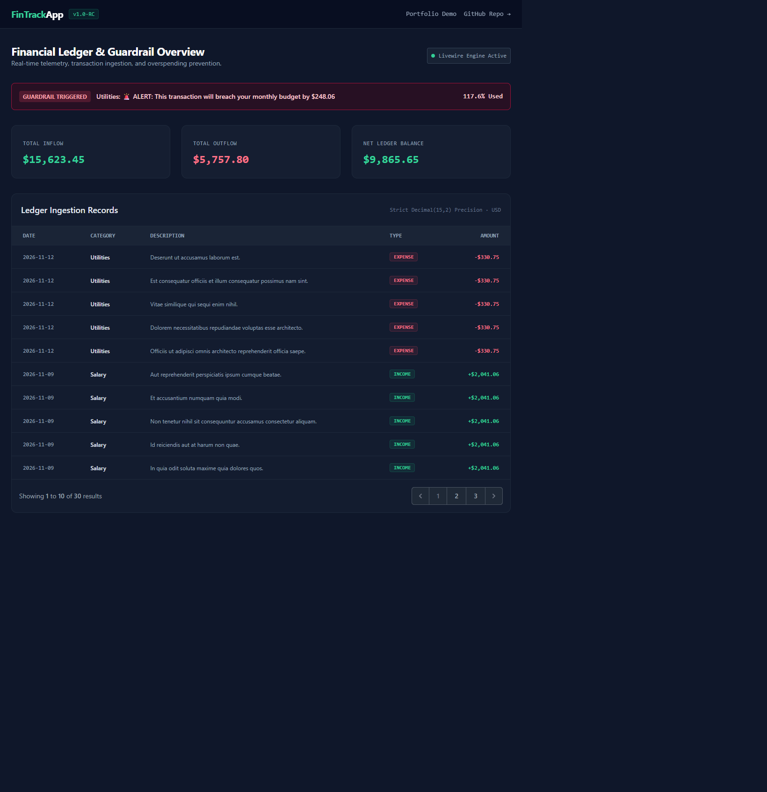

# FinTrackApp


**FinTrackApp** is a high-performance, enterprise-grade **RESTful API & Reactive Financial Telemetry Dashboard** engineered for precise tracking of micro-finance ledgers, digital wallets, and automated payment gateway webhooks.

Built on top of **Laravel 12**, **Livewire**, and **Tailwind CSS**, this system pairs a stateless, Sanctum-secured transaction ingestion API with a real-time **Budget Guardrail Engine** that detects and flags category overspending before thresholds are breached.

---

## Live Telemetry & Guardrail Dashboard



---

## Architectural & Engineering Highlights

- **High-Throughput Webhook Ingestion API**  
  Stateless RESTful endpoints built to capture, validate, and log multi-nested raw JSON payloads from payment gateways and QRIS webhooks with reference-number deduplication.

- **Modular Budget Guardrail Service (`BudgetGuardrailService`)**  
  Decoupled domain service that evaluates incoming expenses against active monthly category caps (`YYYY-MM`) and returns real-time breach telemetry and overage calculations.

- **Reactive Overspending Alerts & Ledger Stream**  
  Real-time administrative control panel powered by Laravel Livewire for instant USD cash-flow metrics, guardrail breach banners, and paginated ledger records without SPA JavaScript overhead.

- **Strict Financial Arithmetic Precision**  
  Eliminates floating-point rounding discrepancies by enforcing `DECIMAL(15,2)` column definitions across all transactional and budgeting schemas.

---

## Technology Stack

- **Backend Core:** Laravel 12 (PHP 8.2+)
- **Reactive Frontend:** Laravel Livewire & Tailwind CSS
- **Database Engines:** SQLite (Local/Testing) · MySQL / PostgreSQL (Production)
- **API & Security:** Laravel Sanctum (Stateless Bearer Token Authentication) & Form Request Validation
- **Automated Testing:** PHPUnit Feature & Unit Test Suites (`RefreshDatabase`)

---

## Project Architecture Blueprint

```text
app/
├── Http/
│   ├── Controllers/
│   │   └── Api/
│   │       ├── AuthController.php             # Stateless Sanctum token issuance & revocation
│   │       ├── TransactionApiController.php   # Ledger CRUD & inline guardrail evaluation
│   │       └── WebhookController.php          # Automated payment gateway & QRIS ingestion
│   ├── Requests/
│   │   ├── StoreBudgetRequest.php             # Monthly cap validation rules
│   │   └── StoreTransactionRequest.php        # Strict ledger payload validation
│   └── Resources/
│       ├── CategoryResource.php               # Standardized JSON category transformer
│       └── TransactionResource.php            # Nested transaction & category JSON resource
├── Livewire/
│   └── DashboardOverview.php                  # Reactive financial metrics & alert engine
├── Models/
│   ├── Budget.php                             # Monthly category budget caps
│   ├── Category.php                           # Income & expense classifications
│   ├── Transaction.php                        # Decimal(15,2) ledger records with JSON payload
│   └── User.php                               # Sanctum-enabled user relations
└── Services/
    └── BudgetGuardrailService.php             # Core overspending detection & overage engine
```

---

## Core API Endpoints

| Method | Endpoint | Auth | Description |
| :--- | :--- | :--- | :--- |
| `POST` | `/api/login` | Public | Authenticate user and issue Sanctum personal access token |
| `GET` | `/api/transactions` | `auth:sanctum` | Retrieve paginated user ledger transactions with categories |
| `POST` | `/api/transactions` | `auth:sanctum` | Store a new transaction and run real-time `BudgetGuardrailService` check |
| `POST` | `/api/webhooks/payment` | Public (Signed) | Ingest automated external gateway / QRIS settlement payloads |

---

## Local Installation & Setup

### 1. Clone & Install Dependencies

```bash
git clone [https://github.com/muhamadmuhibudin/fintrackapp.git](https://github.com/muhamadmuhibudin/fintrackapp.git)
cd fintrackapp

composer install
```

### 2. Configure Environment & Application Key

```bash
cp .env.example .env
php artisan key:generate
```

*(By default, SQLite works out of the box for instant local evaluation. To use MySQL or PostgreSQL, update `DB_CONNECTION` and credentials inside `.env`.)*

### 3. Run Migrations & Demo Seeder

Populate the database schema along with calibrated USD demo transactions and an active budget guardrail scenario:

```bash
php artisan migrate:fresh --seed
```

### 4. Start Local Development Server

```bash
php artisan serve
```

Visit `http://127.0.0.1:8000` to inspect the live financial dashboard and guardrail alert banner.

---

## Running Automated Tests

Execute the PHPUnit test suite covering the `BudgetGuardrailService` breach engine and Livewire dashboard rendering:

```bash
php artisan test
```

---

## Engineering Standards

- **Semantic Conventional Commits:** Atomic commit history strictly following `feat()`, `fix()`, `refactor()`, `test()`, `docs()`, and `chore()`.
- **Separation of Concerns:** Thin controllers delegating validation to Form Requests, transformations to API Resources, and financial rules to dedicated Service classes.

---

## License

This project is open-sourced software licensed under the [MIT License](LICENSE).